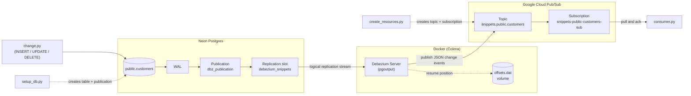

# CDC: Neon Postgres to GCP Pub/Sub with Debezium Server

Log-based change data capture. Debezium Server reads the Postgres WAL through logical
replication (`pgoutput`) and publishes each row change to Google Cloud Pub/Sub.

## Architecture



1. Any client writes to the table (here, `change.py`). Postgres records each committed change in the WAL.
2. The publication filters the WAL down to the tracked table, and the replication slot makes Postgres retain WAL until Debezium has read it.
3. Debezium streams the changes, converts each one into a JSON event (`op`, `before`, `after`, `source`), and publishes it to the Pub/Sub topic.
4. `consumer.py` pulls the events from the subscription and acks them.

Debezium stores its position in `offsets.dat`, so after a restart it resumes where it stopped.

## Prerequisites
- A Neon project with **logical replication enabled** (see [Neon setup](#neon-setup)).
- A GCP project with the Pub/Sub API enabled, and `gcloud` logged in.
- Docker with Compose (for example Colima).

## Neon setup

### 1. Enable logical replication
In the Neon console: open your project, go to **Settings → Logical Replication**, and enable it.

- This sets `wal_level = logical`, which Debezium needs to read row changes from the WAL.
- It restarts the project's compute, and it **cannot be undone** for that project.
- To verify, run this in the Neon SQL editor (it should return `logical`):
  ```sql
  SHOW wal_level;
  ```

### 2. Use the direct connection (turn off connection pooling)
In the Neon console, click **Connect** and turn **Connection pooling** off. The host should then look like
`ep-xxxx.region.aws.neon.tech`, with no `-pooler` in it. Use that value for `NEON_HOST` in `.env`.

**Why:** the pooled endpoint goes through PgBouncer in transaction mode, which hands your session to
different backend connections between transactions. Debezium instead holds one long-lived
replication connection tied to a single replication slot, using Postgres's streaming replication
protocol, and PgBouncer doesn't proxy that protocol. On the pooled host, Debezium fails when it tries to
create the slot or start streaming.

## Setup
```bash
cd cdc/debezium-pubsub
python3 -m venv .venv && source .venv/bin/activate
pip install -r requirements.txt

cp .env.example .env        # fill in the GCP project and Neon details (DIRECT host, not -pooler)

# Credentials for the container (the secrets/ folder is git-ignored)
gcloud auth application-default login
mkdir -p secrets
cp ~/.config/gcloud/application_default_credentials.json secrets/gcp-credentials.json
chmod 644 secrets/gcp-credentials.json   # the container runs as a non-root user
# Do this BEFORE `docker compose up`: if the file is missing, Docker creates an empty
# directory with that name, and Debezium fails with "File does not exist".
# If that happens: docker compose down; rmdir secrets/gcp-credentials.json; then copy again.

python setup_db.py          # table + publication on Neon
python create_resources.py  # Pub/Sub topic + subscription
```

## Run
```bash
docker compose up           # terminal 1: snapshot existing rows, then stream changes
python consumer.py -t 120   # terminal 2: print events
python change.py            # terminal 3: insert, update, delete
```

Expected: `SNAPSHOT` events for existing rows (none on the first run), then `INSERT`,
`UPDATE` (with before and after) and `DELETE` (with before only).

## Things to try
- **Resume:** stop Debezium with Ctrl+C, run `change.py`, start it again. The missed
  events arrive, because the replication slot kept the WAL and the offset file recorded
  the position.
- **Replica identity:** change `REPLICA IDENTITY FULL` to `DEFAULT` in `sql/setup.sql`,
  re-run it, and compare the `before` image of updates.

## Cleanup
An unused replication slot makes Postgres retain WAL indefinitely.
```bash
docker compose down -v      # stops Debezium and deletes the offset volume
```
Then, on Neon (SQL editor or psql):
```sql
SELECT pg_drop_replication_slot('debezium_snippets');
DROP PUBLICATION dbz_publication;
```
And in GCP:
```bash
gcloud pubsub subscriptions delete snippets-public-customers-sub
gcloud pubsub topics delete snippets.public.customers
```
