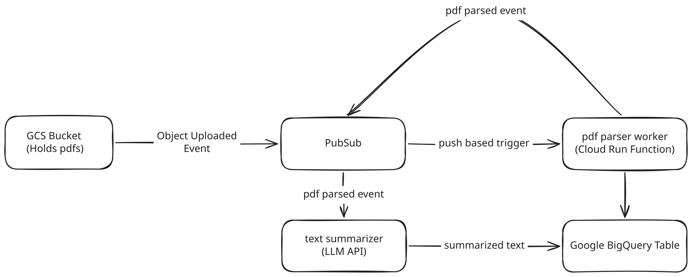

# Event-Driven PDF Parsing Pipeline: GCS → Pub/Sub → Cloud Functions → BigQuery

Event-driven pipeline that automatically parses PDFs uploaded to a Google Cloud Storage bucket,
loads the extracted text and metadata into BigQuery, and forwards the parsed payload to a
downstream Pub/Sub topic for further processing (LLM summarization).

All infrastructure (buckets, topics, IAM service accounts, BigQuery dataset/table, and the 2nd Gen
Cloud Function) is provisioned and torn down with **Terraform** .

## Architecture



1. **Upload Trigger (`OBJECT_FINALIZE`):** Uploading a `.pdf` to the GCS ingest bucket (`<project_id>-pdf-ingest`) triggers a native GCS notification to Pub/Sub Topic 1 (`pdf-uploaded`).
2. **Push-Triggered Serverless Worker (`pdf-parser`):** Eventarc's managed push subscription pushes the payload to the Cloud Function.
3. **In-Memory PDF Extraction (`PyMuPDF`):** The function downloads the PDF bytes  and extracts text.
4. ** BigQuery Batch Load:** The function writes the extracted text and metadata into BigQuery using a Batch Load job.
5. **Downstream Queue (`pdf-parsed`):** The function publishes the extracted text to Topic 2 (`pdf-parsed`) and returns `HTTP 200 OK` so Pub/Sub acknowledges and deletes the Stage 1 message.
6. **LLM Summarization (`pdf-summarizer`):** Eventarc pushes the `pdf-parsed` event to the second Cloud Function (`pdf-summarizer`), which calls the Gemini API (`gemini-3.8-flash` via `google-genai`) and runs a parameterized BigQuery `UPDATE` to populate `summary` and `summarized_at` on the existing `parsed_documents` row.

## Folder Structure

```text
message-queue/gcs-pubsub-bq/
├── assets/
│   └── architecture.excalidraw.svg
├── functions/
│   ├── parser/
│   │   ├── main.py             # Stage 1: PDF extraction & BigQuery load (@functions_framework.cloud_event)
│   │   └── requirements.txt    # Parser dependencies installed by Cloud Build
│   └── summarizer/
│       ├── main.py             # Stage 2: Gemini summarization & BigQuery UPDATE (@functions_framework.cloud_event)
│       └── requirements.txt    # Summarizer dependencies installed by Cloud Build
└── terraform/
    ├── main.tf                 # GCS, Pub/Sub, BigQuery, IAM, and Cloud Function resources
    ├── variables.tf            # Input variables
    ├── outputs.tf              # Created resource names and function URIs
    └── terraform.tfvars.example
```

## Setup & Deploy

```bash
# Authenticate local CLI & Terraform with GCP
gcloud auth application-default login

cd message-queue/gcs-pubsub-bq/terraform
cp terraform.tfvars.example terraform.tfvars   # set project_id and gemini_api_key

terraform init
terraform apply
```

> **Note on New GCP Projects:** In newer GCP projects, the default Compute Engine service account used by Cloud Build (`<project_number>-compute@developer.gserviceaccount.com`) does not have build permissions by default. `main.tf` automatically grants `roles/cloudbuild.builds.builder`, `roles/logging.logWriter`, `roles/artifactregistry.writer`, and `roles/storage.objectViewer` before building the function.

## Test End-to-End

Upload any text-based PDF to the ingest bucket (via the GCP Console UI or CLI):

```bash
gcloud storage cp /path/to/sample.pdf gs://<your-project-id>-pdf-ingest/
```

Query BigQuery to verify the parsed row and LLM summary arrived:

```bash
bq query --use_legacy_sql=false \
  'SELECT doc_id, object_name, page_count, char_count, parsed_at, summarized_at, SUBSTR(summary, 1, 200) AS summary_preview
   FROM `<your-project-id>.pdf_pipeline.parsed_documents`
   ORDER BY parsed_at DESC LIMIT 5'
```

## Teardown

To delete all created resources (Cloud Function, buckets, topics/subscriptions, and BigQuery dataset/table):

```bash
cd message-queue/gcs-pubsub-bq/terraform
terraform destroy
```
