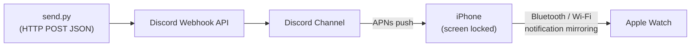

# Push Notifications: Discord Incoming Webhook

Send push notifications from Python to Discord using an **Incoming Webhook**, which iOS mirrors
to your **Apple Watch** via Apple Push Notification service (APNs).

## Architecture



1. `send.py` makes an HTTP `POST` request with a JSON payload to your Discord Webhook URL.
2. Discord posts the message into the target channel and triggers a mobile push notification via APNs.

## Create a Webhook in Discord
1. In a Discord server you control, click **Edit Channel (gear icon)** → **Integrations** → **Webhooks** → **New Webhook**.
2. Click **Copy Webhook URL** and paste it into `.env` as `DISCORD_WEBHOOK_URL`.

## Setup & Run

```bash
cd push-notifications/discord-webhook
python3 -m venv .venv && source .venv/bin/activate
pip install -r requirements.txt

cp .env.example .env        # fill in DISCORD_WEBHOOK_URL (and optionally DISCORD_USER_ID)

# Plain message
python send.py -m "Deployment finished!"

# With a rich embed title
python send.py -t "CDC Alert" -m "Customer row updated in Neon Postgres"
```
